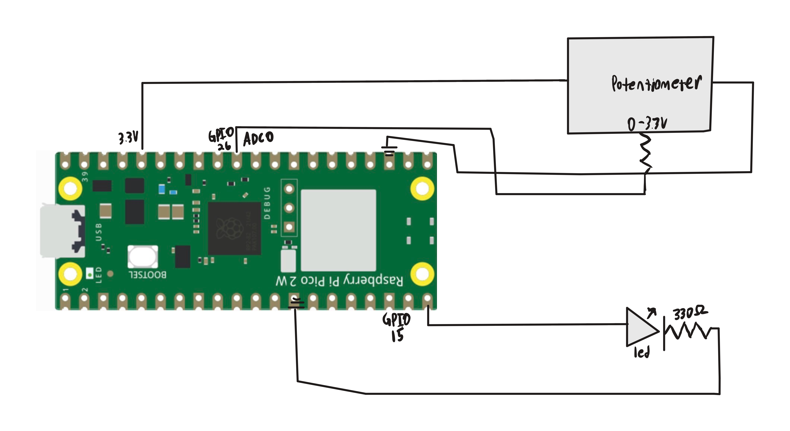

# Overview
We previously learned about the PWM which allowed us to turn our digital voltage values into psudeo-analog values. The ADC just reverses that.
A potentiometer is a type of variable resistor that allows us to modify voltage values from 0% - 100%, but these are not discrete values and have an infinited precision;
impossible to represent digitally. Luckily the Pico has a Analog to Digital converter built in. This takes those non-discrete values of voltages and converts it to a 12 bit integer.
We can then mesaure values from 0-4095 to figure out the % of voltage input. There are 4 channels built in for us to use.

For this project I routed the analog input to ADC channel 0 (GPIO pin 26) and then converted the 12 bit readings into a % brightness value for our LED. We then would set the PWM channel level for GPIO 15 to output a
mimic voltage value of the analog input value. Thus allowing us to control the brightness of the LED.

# Libraries Used
pico/stdlib

hardware/pwm

hardware/adc

# Circuit Diagram

# Demo Video

https://github.com/user-attachments/assets/4f67895c-2f5d-4e4a-af5f-2f3a86cda841

