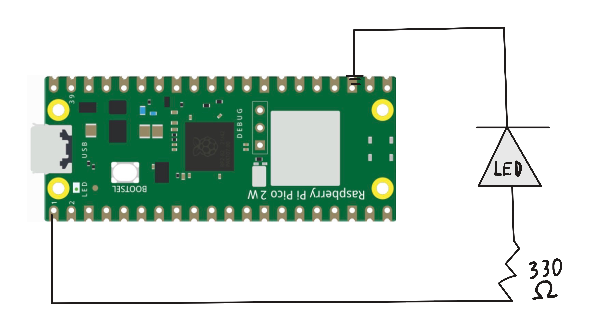

# Overview
The one to start it all... This project helped me understand the basics of circuitry; anodes, cathodes, voltage, ohms, ohm's law. And how to read the PICO's pinout.
Past all the physical circuitry knowledge I learned, I also learned the entire toolchain for creating a pico program, from using cmake to generate makefiles, our cross compiler compiling to the 
ARM's assembly language and learning how to use a linker. All within the GIT BASH command line. More precise details about the process will unfold later when I take away some of the abstraction layers.
Past the toolchain this also taught me what GPIO pins are, how to set their mode, direction, and voltage value. 
# Libraries Used
pico/stdlib.h
# Circuit Diagram

