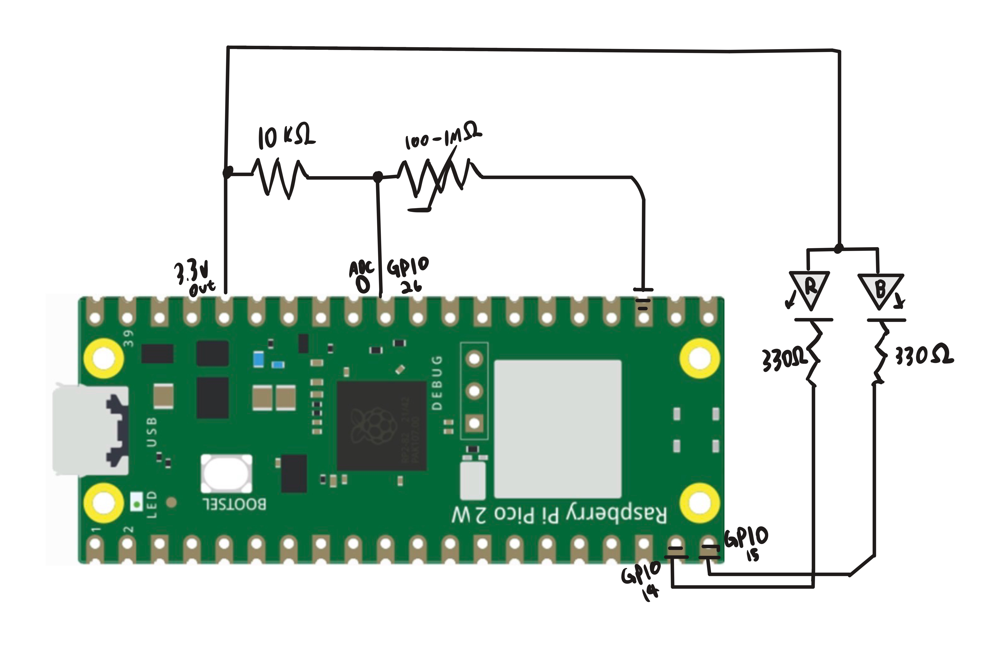

# Overview
This project continues our utilization of the ADC, this time I am using a thermistor in series with a voltage divider.
I am specifically using a Negative Temperature Coefficient (NTC) thermistor, which makes it's resistance go down as the temperature increases.
The general range is 100Ω to 1MΩ. I utilized the following equations to calculate temperature from our flucuating resistance.
 
 

$$
R_{t} = R_{0} \cdot e^{B \cdot (\frac{1}{T_{1}} - \frac{1}{T_{2}})}
$$

$$
T_{2} = \frac{1}{(\frac{1}{T_{1}} + ln(\frac{R_{t}}{R_{0}}) / B)}
$$

Where: 

$$
T_{1},\  T_{2} \ is \ Kelvin\  Temperature
$$

$$
R_{t} = Resistance \ under \ T_{2}
$$

$$ B = Thermal \  Index $$

We use the following Parameters:

$$ B = 3950 $$

$$ R = 10kΩ $$

$$
T_{1} = 25°C
$$

 
I then plugged the output temperature into clamped linear functions to limit our R and B values to the domain [0,4095]. 
R value is proportional to Temperature while B value is negatively proportional.

 
 
Result: A LED that changes color based on the temperature of the thermistor. As temp goes up it turns red, as temp goes down it turns blue.
 
 

# Libraries Used
math.h

stdint.h

pico/stdlib

hardware/adc

hardware/pwm

# Circuit Diagram

# Demo Video
