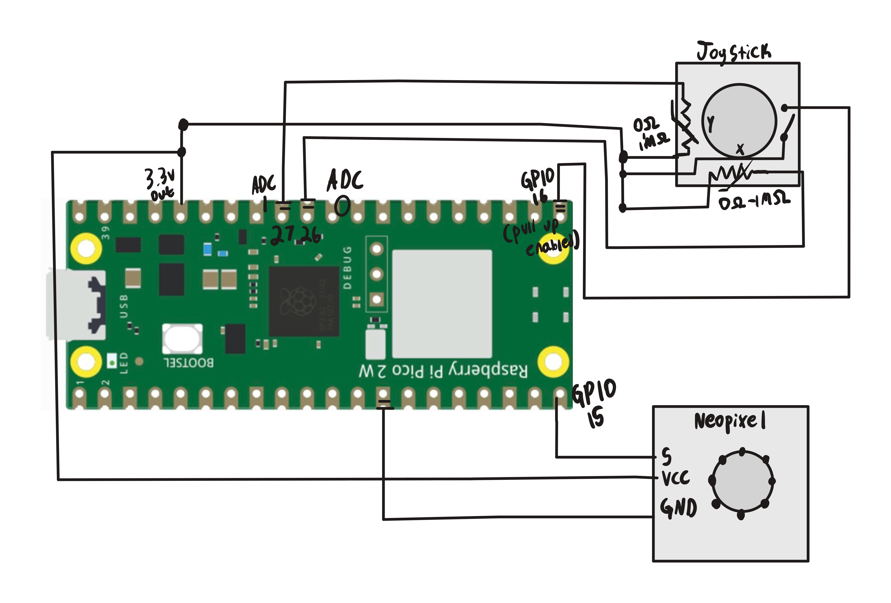

# Overview
This project combined many different embedded systems concepts such as PIO and ADC into one cohesive project.

 
<b>
Implementing the joystick:
</b>

The easier of the two sections. The joystick is composed of two analog potentiometers on the x and y and 1 integrated push switch. 
I utilized the PICO's built in analog to digital converter to read the inputs from the x and y potentiometers. After testing for a bit I determined the neutral position's electrical noise to fluctuate 2048 +- 25.
The digital switch was read using a simple GPIO read with a pullup resistor to prevent input floating and to establish a default state. Those values would then get stored in the joystick_data_t struct
for simplicity and readability.

 
<b>
Implementing the Neopixel communication:
</b>

As established in 05.MP_neopixel_rainbow, the Neopixel utilizes the WS2812 communication protocol for the LEDs. This means that each WS2812 bit period needs to last exactly 1.25µs with 6 clock cycles on HIGH for 1 and 3 clock cycles on HIGH for 0.
The LEDs daisy chain information to each other. The C SDK does not provide deterministic time required for this task so we must utilize the pico's Programmable IO modules. This was especially a challenge this time around because I did it from scratch to test my knowledge on PIO.

To figure out how long each bit period needs to last we use the following formula to calculate it:

$$ clkdiv = \frac{1.25µs \cdot freq_{sys}}{1,000,000\frac{µs}{s}} / CyclesPerBit $$

We will then set the state machine's clkdiv to the resulting value, thus giving us a deterministic time. 

 
<b>
Making the two communicate together:
</b>

The goal of this project was to make the joystick positions correspond to a light on the Neopixel LED. To achieve this effect I created an array of 8 integers each corresponding to one LED.

 

The digital values of x & y have the range of [0, 4095], which isn't ideal for calculations. Instead I normalized the values using the following equation:

$$ pos = (\frac{value}{4095} - 0.5) \cdot 2 $$

I then took those values and converted it to a distance from the center using the following formula:

$$ distance = \sqrt{pos_{x}^2+pos_{y}^2} $$

I then checked if the distance is less than the dead zone tolerance, if so; then ignore the input.

Then converted the normalized x and y values to an index using the following equations:

$$ θ = (atan2(pos_{y}, pos_{x}) \cdot \frac{180°}{π}) + 180° R[0,360] $$

$$ index = round(\frac{θ}{45°}) \% 8 $$

Once we get our index value; we can load the color value into the corresponding index and push it into the TX fifo in our PIO. The PIO code will then handle the bit transfer for us.

Result: A joystick and LED where the joystick position corresponds to the on LED.

# Circuit Diagram

# Demo Video

https://github.com/user-attachments/assets/d7eea784-b6c6-4d97-b874-7fb153cf82ec

# Engineering Challenge(s)

One engineering challenge I had while developing this system was determining the best approach for dead zones; I found the neutral position of the joystick to produce 2048 +- 25. When normalized that means it produced values [-0.012, 0.012]. I initially used square dead zones using the formula:

$$ |\ x| < dead zone ?\  x = 0\  :\  x = x $$

$$ |\ y| < dead zone ?\  y = 0\  :\  y = y $$

But this would prove to be ineffective and cause flickering issues on the corners of the joystick.

After some testing I determined circular dead zones using Euclidian distance was a better approach to resolve the issue:

$$ distance = \sqrt{pos_{x}^2+pos_{y}^2} $$

But after observing the LEDS a bit more, I determined my dead zones were too small and resulted in flickering still. I adjusted the parameters until I found a dead zone of 0.08 to work best. This resulted in much more consistent LED activation without any flickering.

# Libraries Used
math.h

stdint.h

pico/stdlib

hardware/pio

hardware/adc

