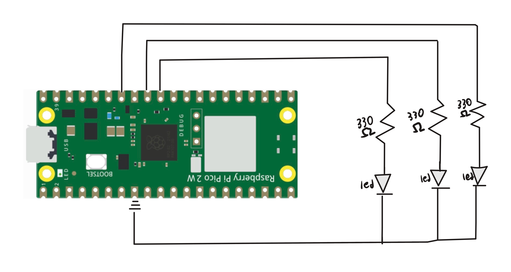

# Overview
This project was a very similar to the singular blink, but this time I connected 3 LED's in parallel with different GPIO pins to start messing with designing more "complex" circuts.
# Libraries Used
pico/stdlib.h
# Circuit Diagram

# Demo Video

https://github.com/user-attachments/assets/132bd24f-2b7a-40c3-931e-68506501853b

