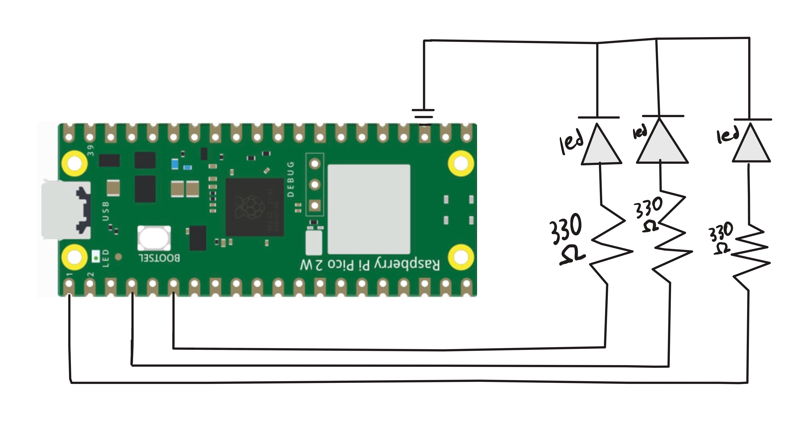

# Overview
This project introduced a very important concept; pulse width modulation. Digital controllers typically only have binary voltage output. HIGH or LOW,and some components need voltages between those values.
Luckily we can actually achieve the effect of having analog values by quickly switching our voltage between high and low in periods using the pico's built in
Pulse Width Module. The pico 2w's PWM has 8 slices (which are our counters) and 2 channels for each slice (our threshold between HIGH and LOW).
# Libraries Used
pico/stdlib.h

hardware/pwm.h
# Circuit Diagram

# Demo Video

https://github.com/user-attachments/assets/83f68ed6-4705-4ee1-938b-e61b59c7d14a

