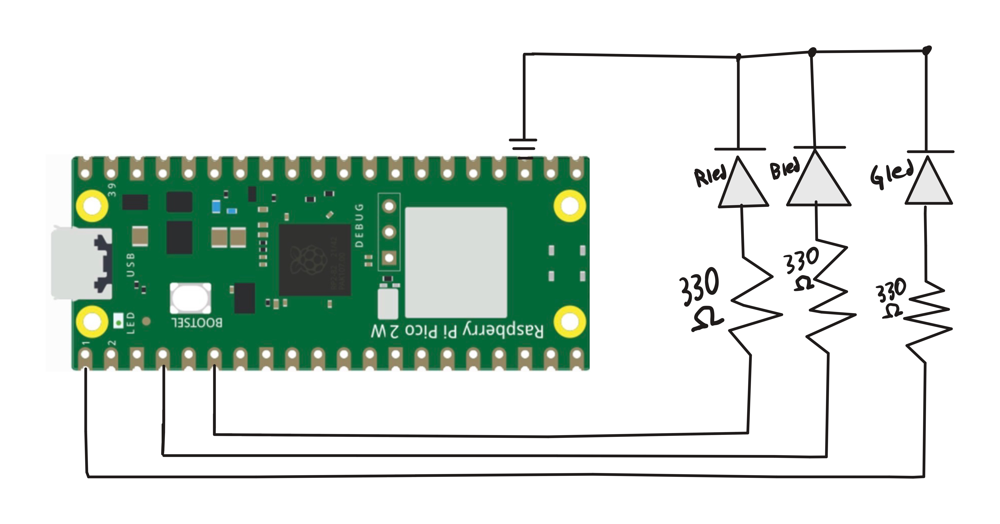

# Overview
The RGB LED provided a fair bit more of a challenge than anticipated. My goal was to make it move through the hue circle; which I though would be easy but I could not be more wrong.

In order to get the effect, I had to create trapezoidal wave functions for each PWM slice that would increment on a timer and have specific offset values so each one can have their own activation time. The RGB LED accepts 3 anodes and one ground pin.
I used this to my advantage by initing 3 different functions for each GPIO pin and just calculating the value in our while loop.

 
# Libraries Used
math.h

pico/stdlib.h

hardware/pwm.h
# Circuit Diagram

