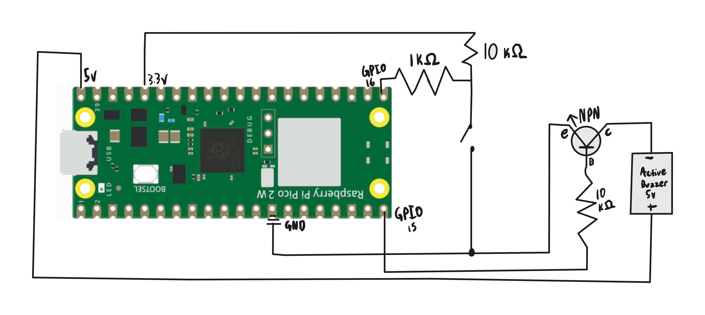

## Overview
This project was much more challenging on the circut side than the code side. It was tough because it required me to not only learn how transisors work, but also how to use switches, & pull up resisors all at once.

NPN transistors are activated whenever the base is given a high voltage while PNP lets current travel through when it has a low or no voltage. 

Pull up resistors are here to let allow us to normalize the currents given to our GPIO pins sometimes there can be electrical noise that can affect our input gpios, so an extra resistor can remove that noise for a true 1 or 0 value.

Switches allow us to connect or disconnect a circut to affect with components are getting power.

# Libraries Used
pico/stdlib.h
# Circuit Diagram

