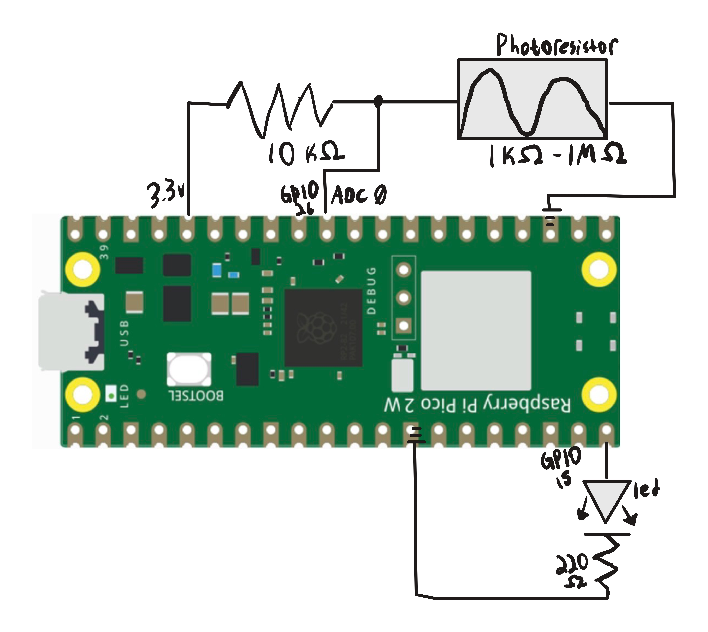

# Overview
This project helped reinforce the ADC topics I learned from the analog_led project. The most important thing I learned was how voltage dividers worked. We utilize 2 resistors in series to change our voltages because the pico's GPIO does not
take meaningful current. 
I utilized a 10 kilo-ohm resistor with a photoresistor in series to detect changes in environmental light, it's resistance is proportional to the darkness in an environment.
By putting our ADC pin input between the 2 resistors, we could have values from 0-3.3v depending on the photoresistor. The formula for our new voltage is as follows:

$$
V_{\text{new}} = V_{\text{old}} \cdot \left( \frac{R_2}{R_1 + R_2} \right)
$$

Notice, as our photoresistors resistance increases, voltage also increases. This is how we will detect darkness to turn on our LED.

# Libraries Used
pico/stdlib

hardware/adc

hardware/pwm

# Circuit Diagram

# Demo Video
